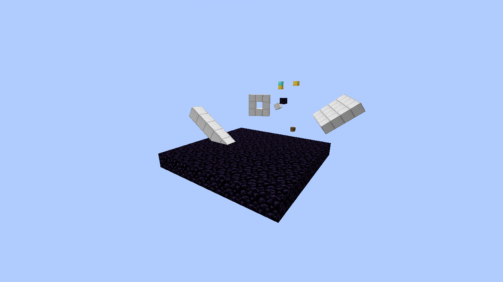
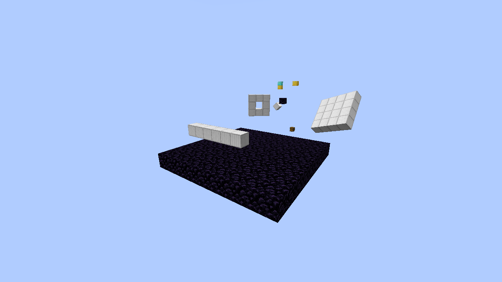

# UNGRAVITY1.1.24-boarding.2 — контактная основа и стабильный поворот корпуса

Дата:28 октября2026. Это промежуточный этап Master ТЗ, не завершённый Dynamic Boarding.

- Проверенные исходники: `a1b045cde046d2a9f3be932eae960ed28bd4e083`.
- Установочный JAR SHA-256: `19dbbeb2eacde9d7d587bf77780b6342c2394147d2631a88614c5e3007eb7c6a`.
- Локальный Gradle build/unit/remap gate прошёл. JUnit:598/598; Python:29/29.
- [Точный CI-прогон](https://github.com/terminaldetector/ReforkDescnt/actions/runs/40683605278)
  прошёл:598 unit,147 GameTests, полный клиент, snapshot-инвентарь, Fabulous и LOD.
  Точный JAR CI совпал с обоими локальными native-прогонами по SHA-256.

## Что изменилось

BodyCollisionQuery делает world-space contact/sweep-запросы к неизменному локальному
BVH корпуса. SAT использует реальные OBB, относительный линейный CCD учитывает
движение обеих сторон. BodyContactConstraint передаёт равные противоположные
импульсы двум существующим D6-телам с инерцией, скоростью точки v+ω×r и ограниченным
трением; не прикрепляет объект жёстко и не перемещает его телепортацией. Этот же
решатель используется для опоры BlockBody на terrain.

В1.1.24-boarding.1 численные и клиентские контакты прошли, однако осмотр кадров
выявил старый дефект renderer: каждый partial tick повторял интерполяцию от
previousRotation даже после остановки корпуса. Физическая колонна уже лежала,
но её модель снова показывала промежуточный наклон. В1.1.24-boarding.2 добавлена
монотонная временная шкала ориентации: закончившийся поворот не повторяется,
velocity-only пакеты и дополнительная камера не сбрасывают его.

## Native Cubic Chunks — новый прогон именно этого JAR

| Среда | Сцен | Завершённых кадров сцены | Проверенных кадров остановившегося угла |
|---|---:|---:|---:|
| OpenGL3.2 / GLSL150 |5|450|60|
| Sodium0.8.13 / OpenGL3.3 / GLSL330 |5|450|60|

В обеих средах прошли реальные серверные запросы compound-контакта к повёрнутой
палубе, relative CCD, реакция двух D6-тел, опора и опрокидывание физической колонны,
сохранённый проход в оболочке и отказ неизвестного native-куба по Y без его загрузки.
Каждая из5 сцен требует90 реальных вызовов renderer. Всего10 PNG и900 завершённых
кадров. Камеры/PNG осмотрены: палуба держит полученный угол, колонна отображается
лежащей на опоре. Последующий поворот палубы выполняется уже после её появления
у клиента; проверяется quaternion, реально переданный производственным renderer
в MatrixStack.multiply. Это не проверка только getter или отдельной картинки.

Native metadata содержит точный чистый source SHA, SHA-256 игрового JAR и отдельного
gate-JAR; подтверждено совпадение всех runtime mods с manifests. DUMMY-строк:0.
Better Cubic Chunks0.1.1+mc1.21.1 SHA-256:
`8660f6e18fafaaa1dea2ef344e86188a943b0f3661c65fdcd294f326f3c6e8b6`.
Закрытый BCC-бинарник в архивы доказательств не включён. Проверки выполнены на
программной графике llvmpipe/Linux, без сертификации Windows/RTX3060 или HD4400.

## Контрольный провал и сохранённые ошибки

Тот же новый native harness запущен с прежним опубликованным JAR1.1.24-boarding.1
(SHA-256 `ddd94a30639af99a39c573354121d97ffb8a200046ae26ead514edd849c695fc`).
Он ожидаемо завершился кодом255 на `stationary hull replays its old rotation when
partial tick wraps`. Лог, crash report, manifest и предыдущие кадры сохранены в
[preserved-failures.zip](preserved-failures.zip). Это отрицательный контроль,
не провал исправленного JAR. Пороги проверки после контроля не ослаблялись.

В тот же архив включены первые два численных провала при расчёте точки контакта
повёрнутых OBB. Исправлены проекции опорных поверхностей; исходное ожидаемое значение
теста сохранено. Первоначальный локальный Gradle был заблокирован до компиляции
запретом TCP-сокета; после появления сетевого доступа настоящий Gradle build прошёл.
Первая подготовка native-клиента потребовала отдельного remapCubiccheckJar; это
ошибка подготовки gate, при которой игровой клиент ещё не запускался.

## Ограничения и незакрытые требования

- Contact/CCD проверены на малых инертных корпусах; лимит адаптера256 блоков/16³
  не расширялся до большого UFO/маточника. Точный angular CCD и полноценный contact
  manifold ещё не готовы.
- Запросы и решатель не подключены к travel игрока/мобов. Во всех JSON явно
  `playerBoarding:false`. DynamicBodyAttachment, ходьба/прыжок внутри движущегося
  корабля, единый порядок обновления, сетевое предсказание и коррекция остаются OPEN.
- Локальное редактирование/механизмы, joints, ControlCore, migration текущего UFO,
  полноценный3D AI и сетевые/persistence-критерии ТЗ ещё не закрыты.
- Все12 критериев Boarding и9 критериев UFO остаются OPEN. Этот отчёт не выдаёт
  небольшую физическую сцену за завершённую летающую игровую локацию.

[Проверенные manifests/JSON, XML, логи и кадры](native-contact-evidence.zip).
[Машинная проверка](VERIFIED_NATIVE.json). Архив содержит verify-native.py;
он проверяет source/JAR hashes, чистый diff, свежие PNG, реальные frame counts,
две среды, завершённую интерполяцию и воспроизведение ошибки на старом JAR.

## Сравнение фактических кадров

Одинаковая камера сцены опоры. Падение считает один и тот же контактный решатель;
до исправления модель возвращалась к промежуточному углу.

|1.1.24-boarding.1: повторение старого угла|1.1.24-boarding.2: фактическое положение|
|---|---|
|||

[Палуба GL3.2](native-frames/gl32-compound-contact-query.png) ·
[Палуба Sodium](native-frames/sodium-compound-contact-query.png).
