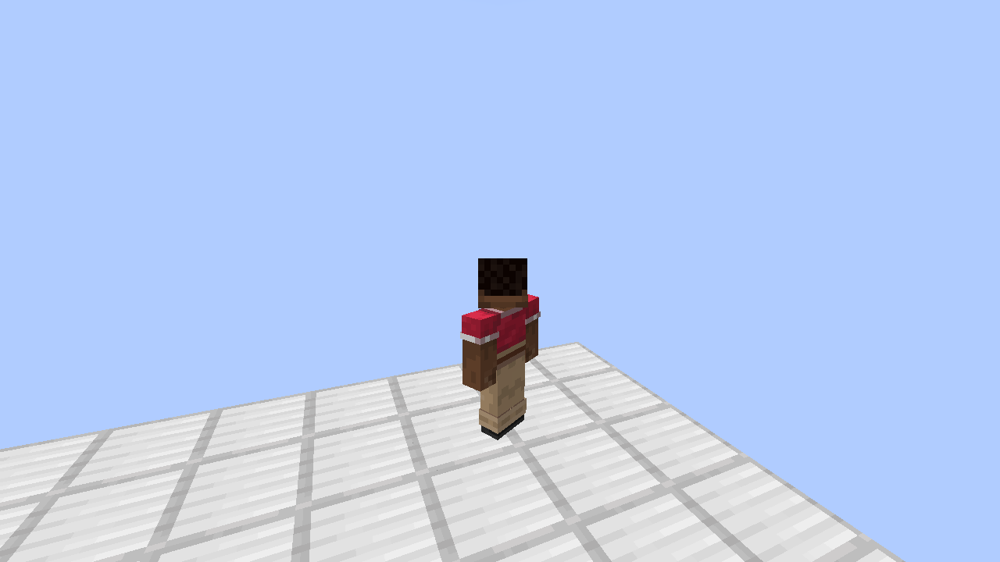
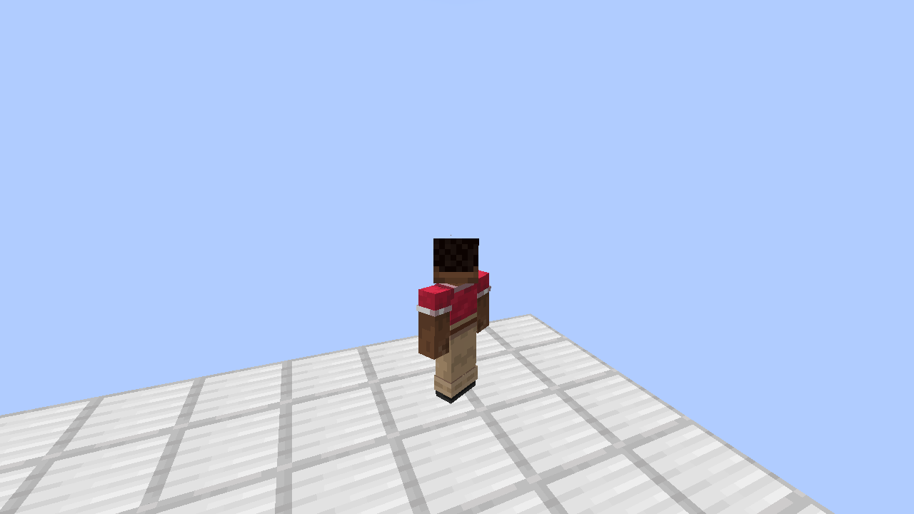

# UNGRAVITY 1.1.25-boarding.1 — первая игровая посадка на BlockBody

Проверенный исходник: `c04365a693910644a623260343b92504d7f26f23`.
Установочный JAR: `drmd-6dof-1.1.25-boarding.1-fabric-1.21.1.jar`, 2 054 724 байта.
SHA-256: `3956d89496c80c5e33fb512708304879deeb7ddc9daa5c397d3541153d48c956`.

Серверный контакт позволяет приземлиться, ехать, ходить и прыгать с настоящего
физического BlockBody. Нейтральная ходьба сохраняет скорость палубы через трение;
шагающий игрок сообщает ей противоположный импульс. Прыжок сохраняет мировую
скорость, включая полученную вращательную составляющую, без повторного сложения.
Это этап с world-UP, а не полный абордаж UFO с корабельной гравитацией.

## Проверки

[Полный CI-прогон](https://github.com/terminaldetector/ReforkDescnt/actions/runs/40730492270) прошёл: 608 unit, 153 серверных GameTests, 33 Python-проверки,
основной клиент, оружие, реальный ввод/инвентарь дрона, зеркала/порталы с Fabulous,
LOD и отдельный boarding-клиент. Исходный архив и проверенные артефакты Actions
подтверждены отдельно. SHA-256 опубликованного CI JAR совпадает с обоими native-прогонами.

CI boarding-клиент: 95 подтверждённых команд, максимальная
ошибка 0.252429 блока, ошибка горизонтальной скорости
прыжка 0.000000 м/с. В полном клиентском прогоне двигались
все128/128 дронов; максимум96 кандидатов на spatial query.

Свежие локальные клиенты на том же исходнике:

| Среда | Высота палубы | Подтверждённые команды | Максимальная ошибка предсказания | Ошибка горизонтальной скорости прыжка |
|---|---:|---:|---:|---:|
| Native BCC, GL 3.2 / GLSL150 | 2156 | 90 | 0,058635 блока | 0 м/с |
| Native BCC + Sodium 0.8.13, GL 3.3 | 2156 | 93 | 0,033604 блока | 0 м/с |
| Обычный мир, dev-клиент | 140 | 96 | 0,019585 блока | 0 м/с |

Оба native-клиента запускали установочный remapped JAR с указанным SHA-256.
Обычный dev-клиент запускал named-выход того же чистого исходника; это отдельно
указано в inputs.json. Native Better Cubic Chunks: 0.1.1+mc1.21.1, SHA-256
`8660f6e18fafaaa1dea2ef344e86188a943b0f3661c65fdcd294f326f3c6e8b6`.
Приватный upstream JAR и исходные пользовательские сохранения в архив не входят.

Каждый клиент выполняет пять сцен с реальными клавишами W/Space и C2S/S2C:
посадка, удержание, ходьба, момент отрыва и переход обратно в 6DoF. До нажатия
прыжка потеря server lease немедленно проваливает прогон. После прыжка требуется
повторное приземление; затем поддельные координаты +100 и sequence +10000 не
должны нарушать действующее управление. Финальный H/toggle отдаёт движение 6DoF.
Каждый кадр сохранён после трёх завершённых render frames.

Ошибка предсказания измерена по одной и той же подтверждённой команде до replay,
не по несинхронным live-позициям разных тиков. Порог остаётся <0,8 блока,
горизонтальная ошибка прыжка <0,03 м/с, минимум 30 сопоставленных команд.
Тестовая палуба имеет настоящую ограниченную тягу и управляющий момент для yaw;
поза и скорость не перезаписываются для переноски игрока. Свободная плита может
физически опрокинуться под смещённым пассажиром — это не искусственная гравитация.

[Машиночитаемые результаты](VERIFIED_NATIVE.json) ·
[Все логи, манифесты и кадры](native-boarding-evidence.zip) ·
[Первые сбои](preserved-failures.zip).

## Фактические кадры

| Ходьба, native GL 3.2 | Ходьба, native Sodium |
|---|---|
|  |  |

[Посадка](native-frames/gl32-landing.png) · [Удержание](native-frames/gl32-riding.png) ·
[Момент отрыва](native-frames/gl32-jump.png) · [6DoF](native-frames/gl32-sixdof-handoff.png).
Остальные кадры обоих native и обычного клиента находятся в native-frames/.

## Сохранённые первые сбои

Первый численный длинный контакт терял опору на 38-м тике: опора теперь
проверяется у конечной позы корпуса. Реальная Entity.move пропускает delta²≤1e-7;
малые overlap-коррекции раньше теряли время CCD, а короткая доля до столкновения
ошибочно считалась стеной и обнуляла скорость. Добавлены две регрессии этого порога.

Первый CI `23959fbc1f6f6268c86455b2e98092b20da3534f` завершился ошибкой
нового тестового initializer, помещённого в mixin package. Исходник и диагностика
этого запуска действительно сохранены в Actions; установочный пакет не опубликован.
Сами mixin-классы перенесены в отдельный пакет.

Обычный клиент обнаружил отставание после загрузочного stall: небольшие ошибки
по-прежнему сглаживаются, большое накопленное расхождение исправляется до следующей
команды через collision-checked Entity.move. В тестовом сценарии раннее подтверждение
прыжка также оставляло Space зажатым; отпускание теперь связано с переходом сцены.
Ни один из неуспешных или более слабых промежуточных прогонов не засчитан финальным.

## Управление и открытая часть ТЗ

H выключает 6DoF для ходьбы; посадка на допустимую поверхность настоящего
`drmd:block_body` включает контакт автоматически. WASD — ходьба, Space — прыжок,
H — возврат в 6DoF. Существующие `/d6body assemble`, `impulse`, `spin` сохранены.
Физический контакт не подключён к старому виртуальному `drmd:sky_ufo`.

Не выполнены ship-UP гравитация/полный 6DoF персонажа, ориентированный пассажир
в перевёрнутом интерьере, пассажиры-мобы и предметы, BlockBodyWorldAccess для
редактирования и механизмов, joints, ControlCore, большой UFO и полноценный 3D AI.
Dedicated server с двумя клиентами, сетевое наблюдение другим игроком и сохранение
полного абордажа не проверены. Все 12+9 критериев целиком остаются OPEN.
Графика локальных прогонов — Linux/llvmpipe; Windows/RTX ими не подтверждены.
