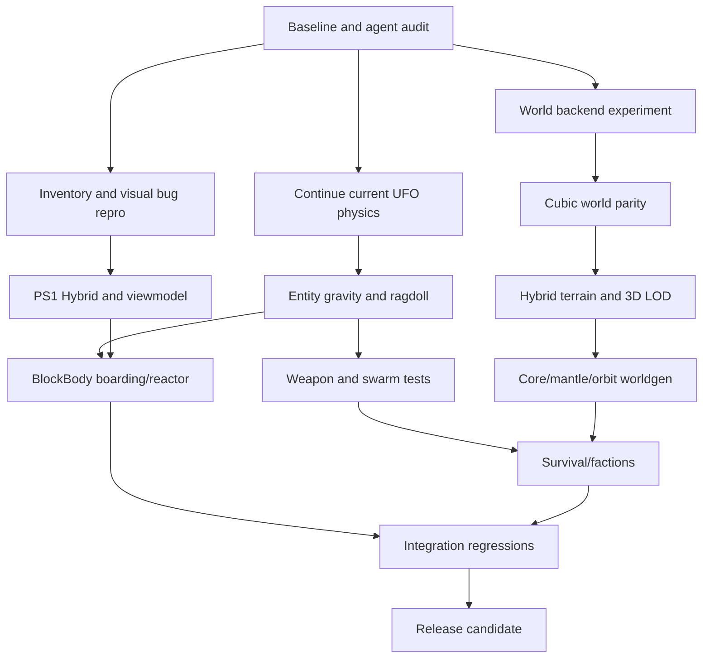

# EXECUTION — 18 STAGES / 99 TASKS / GATES
**High-level staging:** continuity is more important than doing everything at once. v7 had 18 stages and 99 atomic tasks; v8 retains this format, adding world/lore and PS1 Hybrid without pretending implementation exists.

## Dependency graph

## Implementation gates
- **G0 Source/JAR:** exact tree, version, CI, GPU, pinned baseline, all status `UNKNOWN` until verified.
- **G1 World:** cubic new world loads persistently, 3D cube streaming, no server death or BE corruption, a failed dependency is not silently reimplemented.
- **G2 Physics:** 6DoF player/mobs/ragdoll/BlockBody, local gravity, no trapped proxy, first 128 drones running.
- **G3 Visual:** Hybrid terrain ON, PS1 mode selectable, no missing mirrored surface or 6DoF hand clipping, no unlicensed shader assets.
- **G4 Gameplay:** ordnance, drills, reactor, boarding, survival threat loop with recoverability.
- **G5 World design:** science-fiction zone structure, Citadel, ruined ring, staged procedural/hand-authored assets, validated worldgen budget.
- **G6 Release:** same exact candidate JAR passes gameplay, physics, save/load, fps/mspt, status audit; evidence signed with hashes.

## Parallel merging
A world backend migration, B UFO/physics continuation, C client render and D cleanup may run in separate Git worktrees. Never edit same source files from separate agents simultaneously. Use interface RFC before merging shared classes. Merge only in temporary integration branch, use cherry-pick of scoped known commits, rollback on regression; avoid forced pushes.

## Risk/Cost
High: cubic beta compatibility, physical ship transforms, any-mob 6DoF collision, ragdoll contact solver, renderer with Sodium GL3.2. Medium: spatial boids and structured ordnance, PS1 postprocess, city generation, faction save data. Lower: distinctive GUI icons, HUD debug cleanup, lore documents. Assign time by measured evidence, not by apparent number of lines of code.
